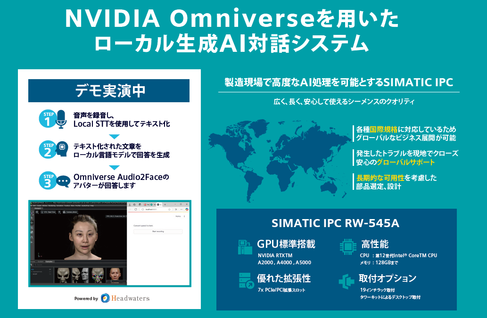

AI Engineer with experience in Machine Learning, Computer Vision, and Reinforcement Learning.
Strong background in mathematics, problem-solving, and computational thinking.

[Email](mailto:longpml3421@gmail.com) | [LinkedIn](https://linkedin.com/in/longpml/) | [GitHub](https://github.com/LongPML) | [CV (PDF)](cv.pdf)

## Highlights

### Conversational AI Digital Human (2024)
Sole developer, end-to-end. Headwaters Co., Ltd.

- Fully offline voice assistant with a real-time 3D talking avatar: local speech-to-text, local LLM, NVIDIA Omniverse Audio2Face.
- Runs on a Siemens SIMATIC IPC RW-545A industrial PC (NVIDIA RTX A6000), no cloud dependency.
- Exhibited at Japan Robot Week 2024, Food Tech Japan 2024, and SEMICON Japan 2024. [Press release](https://www.headwaters.co.jp/news/digital_human_japan_robot_week_2024.html)

### eKYC Face Attendance (VinBigData, 2023)
- Real-time face attendance tracking: 0.98 F1-score at 0.1 s/person.

### Deep RL Stock Trading (2022)
- Automated trading on HOSE: 70.3% cumulative return over 2019 to 2022.

See all in [Experience](experience.html).
